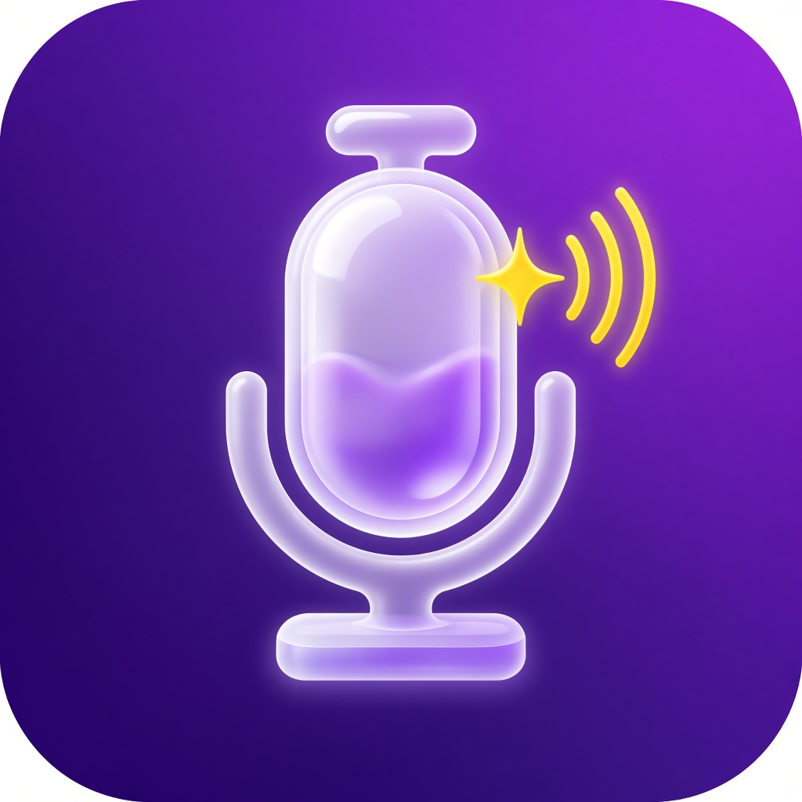

# PodAI (Flutter)



**PodAI** é um aplicativo móvel (Android e iOS) que gera **podcasts de
aproximadamente 2 minutos** a partir de notícias publicadas **nas últimas 72
horas**, em **6 temas predefinidos**. Identidade visual em roxo e amarelo com
interface *liquid glass* — veja [`BRAND.md`](BRAND.md).

| Tema | O que cobre |
|------|-------------|
| Tecnologia | Inovação, IA, gadgets e startups |
| Economia | Mercado financeiro, inflação, juros e negócios |
| Esportes | Futebol, olimpíadas e competições |
| Ciência | Pesquisas, espaço e descobertas |
| Saúde | Medicina, bem-estar e saúde pública |
| Política | Governo, congresso e eleições |

## Como funciona

1. **Busca de notícias** – `lib/services/news_service.dart` consulta o feed RSS
   público do Google Notícias (pt-BR) com o filtro `when:3d`, e depois valida
   localmente a data de cada item: **nada com mais de 72 h entra no episódio**.
   Não é necessária nenhuma chave de API.
2. **Roteiro** – `lib/services/script_generator.dart` monta, no próprio
   aparelho, um roteiro em português com abertura, um parágrafo por notícia
   (citando fonte e "há X horas") e encerramento. O número de palavras é
   calibrado para **~2 minutos** na velocidade de voz escolhida
   (≈300 palavras a 150 ppm).
   Opcionalmente, em *Configurações*, dá para informar uma chave de API
   compatível com OpenAI para que um modelo de linguagem escreva o roteiro.
   Se a chamada falhar, o app volta ao gerador local.
3. **Áudio** – `lib/services/tts_service.dart` narra o roteiro com o
   sintetizador de voz do sistema (`flutter_tts`, voz pt-BR), parágrafo por
   parágrafo, com play/pause/parar, barra de progresso e destaque do trecho
   sendo lido. Funciona offline depois que as notícias foram baixadas.

## Requisitos

- [Flutter](https://docs.flutter.dev/get-started/install) 3.22 ou superior
  (Dart 3.4+).
- Android Studio (SDK Android) e/ou Xcode (para iOS, somente no macOS).
- Um aparelho ou emulador com **voz em português instalada**
  (Android: *Configurações → Sistema → Idiomas → Saída de conversão de texto em voz*;
  iOS: já vem com vozes pt-BR).

## Primeira execução

O pacote contém o código-fonte Dart, o `pubspec.yaml`, os testes e o
`AndroidManifest.xml` com as permissões necessárias. As demais pastas nativas
(`android/`, `ios/`) são geradas pela própria ferramenta do Flutter para a sua
versão instalada, o que evita incompatibilidades de Gradle/CocoaPods.

```powershell
# Windows
.\setup.ps1
```

```bash
# macOS / Linux
chmod +x setup.sh && ./setup.sh
```

Os scripts executam:

```bash
flutter create . --platforms=android,ios --project-name news_podcast_app --org br.com.podai
flutter pub get
dart run flutter_launcher_icons   # aplica o ícone PodAI no Android e iOS
flutter test
```

> `flutter create .` **não sobrescreve** arquivos existentes, então o código em
> `lib/` e o manifesto Android são preservados.

## Executar no celular

```bash
flutter devices          # confira se o aparelho/emulador aparece
flutter run              # instala e abre o app
```

Gerar o APK para instalar manualmente em um Android:

```bash
flutter build apk --release
# arquivo em build/app/outputs/flutter-apk/app-release.apk
```

Para iOS, abra `ios/Runner.xcworkspace` no Xcode, selecione sua equipe de
assinatura em *Signing & Capabilities* e rode em um iPhone, ou use
`flutter build ipa`.

## Estrutura

```
lib/
├── main.dart                     # inicialização, tema e providers
├── theme/app_theme.dart          # paleta roxo/amarelo e ThemeData
├── widgets/
│   ├── glass.dart                # painéis, botões e chips em liquid glass
│   └── podai_logo.dart           # símbolo e wordmark PodAI
├── data/themes.dart              # os 6 temas, janela de 72h e duração alvo
├── models/                       # NewsArticle, PodcastTheme, PodcastEpisode
├── services/
│   ├── news_service.dart         # RSS + filtro de 72h
│   ├── script_generator.dart     # roteiro local (~2 min)
│   ├── ai_script_service.dart    # roteiro por IA (opcional)
│   ├── tts_service.dart          # narração / player
│   └── app_settings.dart         # preferências persistidas
└── screens/
    ├── home_screen.dart          # grade com os 6 temas
    ├── podcast_screen.dart       # player, roteiro e fontes
    └── settings_screen.dart      # voz, velocidade e IA
test/                             # testes de 72h, RSS e tamanho do roteiro
```

## Ajustes rápidos

- **Temas**: edite `kPodcastThemes` em `lib/data/themes.dart` (nome, cor,
  ícone e termo de busca).
- **Janela de tempo**: `kMaxArticleAge` no mesmo arquivo (padrão 72 h).
- **Duração**: `kTargetEpisodeDuration` (padrão 2 min). O número de palavras é
  recalculado automaticamente de acordo com a velocidade da voz.
